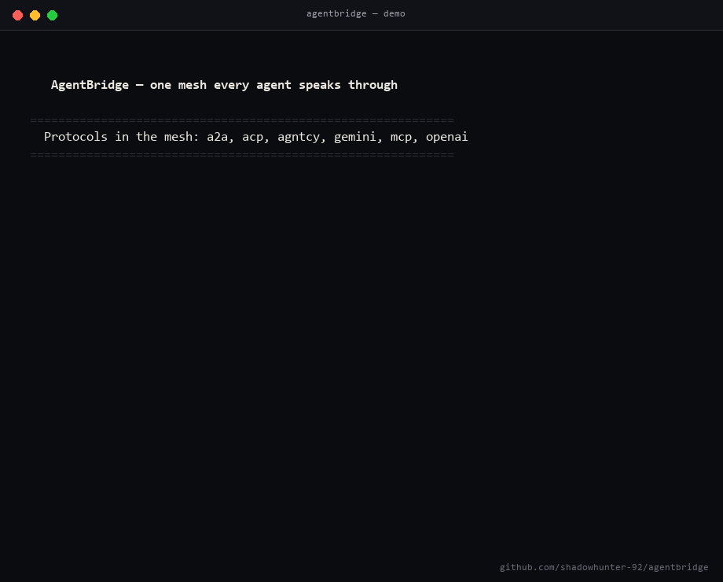
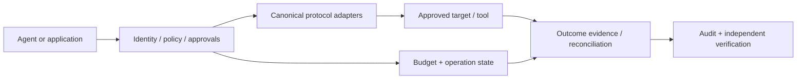

# AgentBridge

Governed MCP proxy for consequential tools — identity, budget, human approval,
and independently verifiable evidence of what actually ran.

**Engineering alpha; production NO-GO.** The runnable example below is a
synthetic local transfer over an actual MCP stdio connection. Its separate
read-only observer and offline verifier check the exact signed action. Both
keys and the SQLite file remain under one local operator; this demonstrates
verification, not independent institutional custody or real payment completion.

## Run the governed demo

With Git and Docker Compose available, run these three commands in a terminal:

```sh
git clone https://github.com/shadowhunter-92/agentbridge.git && cd agentbridge && git checkout --detach f309a35cb5c3ec4164acea5ba2622dc04be6807c
docker compose -f demo/governed-mcp-demo/docker-compose.yml run --build --rm demo
docker compose -f demo/governed-mcp-demo/docker-compose.yml run --rm verify
```

Type `APPROVE` at the second command's prompt, then run verification within
five minutes. The first build downloads dependencies; the demo and verifier
run without networking. Use `compose run` for interactive stdin. Evidence stays
in the named volume; a repeated run requires a fresh `DEMO_RUN`, not deleting
the previous evidence. The source pin is the reviewed executable baseline;
this README and the kits are a later documentation addition.

[Native install and evaluator checklist](evaluation/external_validator_kit/README.md)
· [Demo and fault scenarios](demo/governed-mcp-demo/README.md)
· [Structured feedback](evaluation/external_validator_kit/feedback.md)

## Current limitations

- Synthetic tools only: no Stripe API, credentials, money movement or LLM is
  needed or exercised. Native Stripe fencing and a complete PaymentIntent
  state machine are not implemented by this demonstration.
- Lost acknowledgments preserve UNKNOWN and reserved exposure. There is no
  automatic resend, reconciliation, refund or proof that an absent observation
  means the action failed.
- A signed receipt authenticates its signer's statement. Independent operator
  custody, authoritative external effects, physical HA, combined workload
  identity/CNI isolation, broad protocol lifecycle conformance and production
  performance SLOs remain unqualified.
- This local container recipe is not a signed published release or complete
  supply-chain qualification. Independently returned evaluations, security
  acceptance, buyer interviews and a supervised pilot remain open.

> **Production target restriction:** HTTP named-target execution is disabled for
> generic MCP/A2A/ACP transports in `prod` and `production` until destination-atomic
> authority/fencing is qualified. Translation and nonproduction synthetic evaluation
> remain available. See [destination contract](docs/PRODUCTION_TARGET_QUALIFICATION_2026-10-14.md).

[](https://github.com/shadowhunter-92/agentbridge/actions/workflows/ci.yml)
[](https://www.python.org/)
[](LICENSE)
[](SECURITY.md)

AgentBridge is an open-source Python project for translating selected AI-agent
tool-call formats and applying agent identity, authorization, budgets,
approvals and audit history alongside existing frameworks and gateways.
[Current source, evidence and open gates](docs/CURRENT_ALPHA_STATUS.md) ·
[Documentation index](docs/README.md) · [Security policy](SECURITY.md)



## Protecting the code and release boundaries

This code is published under Apache 2.0; the existing license grants remain in force. Security-critical changes require review and must not imply certification. See [code/IP safeguards](docs/CODE_PROTECTION_AND_IP_POLICY_2026.md), [four-product execution criteria](docs/FOUR_PRODUCT_EXECUTION_GATES_2026.md), and the [security policy](SECURITY.md). The reconciled R4 engineering work and reviewed fixes are incorporated in `main` through [PR #41](https://github.com/shadowhunter-92/agentbridge/pull/41). Production acceptance remains open.

## Why AgentBridge?

AI-agent frameworks can call tools, but organizations also need to answer:

- **Who** requested an action, and with which authority?
- **Exactly what** parameters, target and cost were authorized?
- **What happened** if the connection dropped after execution?
- **What evidence** can an independent reviewer actually verify?

The protocol mesh provides a useful starting point. The evolving Trust and
Evidence components aim to address the more difficult authorization, ambiguous
outcome, reconciliation and auditability questions. Those guarantees remain
**scope- and destination-dependent**, not universal.

## At a glance

| Capability | Maintained implementation scope | Qualification remaining |
| --- | --- | --- |
| Canonical tool-call translation across six adapter families | Limited subset with explicit unsupported-feature rejection | Full protocol lifecycle/version matrix |
| Agent signatures, budgets, policies and approval controls | Selected paths; opt-in enrolled tenant SDK/HTTP and shared-SQL admission/settlement | Remaining ingress, destination and adversarial qualification |
| SQLite / PostgreSQL support | Bounded tenant namespaces, offline migration, admission caps, retained-task/event/audit-payload caps and shared tenant stream allocations | Reference-indexed hold-safe retention, physical storage bounds, large-history performance, physical connection limits, live migration and HA |
| Separately signed action receipt + readback verification | Tested in bounded sandbox / PostgreSQL paths | Independent administration and real destination acceptance |
| Production network isolation, HA and full MCP/A2A conformance | **Not qualified** | **Still not qualified** |
| Native queued tasks | Signed acceptance and atomic admission; private one-shot synthetic dispatch, bounded result and read-only recovery | Public worker/transport, historical-key recovery, acknowledged remote cancellation and production qualification |
| Enterprise managed service or formal certification | Not available | Not available |

**Protocol families:** MCP, A2A, BeeAI ACP, OpenAI tool calling, Gemini tool
calling and AGNTCY ACP. A 6 × 6 basic call translation matrix does **not**
imply all sessions, streaming, async tasks, extensions or current-version
transports are interoperable. See [protocol details](docs/PROTOCOL_SUPPORT.md)
and the [review compatibility contract](docs/PROTOCOL_COMPATIBILITY_2026.md).

## Basic translation examples

**Requires Python 3.11 or 3.12.** Use a new virtual environment and synthetic
or non-sensitive data for the examples.

```bash
git clone https://github.com/shadowhunter-92/agentbridge.git
cd agentbridge
# Pin the reviewed executable baseline:
git checkout --detach f309a35cb5c3ec4164acea5ba2622dc04be6807c
python -m venv .venv

# Activate your virtual environment first:
# macOS/Linux: source .venv/bin/activate
# Windows PowerShell: .venv\Scripts\Activate.ps1

python -m pip install -e ".[mcp]"
python examples/quickstart.py
python examples/demo_story.py
```

This baseline includes opt-in tenant governance, signed queued acceptance,
private preparation, [first-admission linkage](docs/QUEUED_INTENT_PREPARATION_2026-10-18.md),
bounded private dispatch and retained journals. These basic examples exercise
translation; use the governed demo above for the bounded action/evidence route.
Use the documented opt-in tenant factory for tenant features. Editable source
installation remains separate from the older unsigned local evaluator wheel
and any signed published release. The CI badge tracks moving `main`; record
the [exact source and its own evidence](docs/CURRENT_ALPHA_STATUS.md).

To execute the local test suite:

```bash
python -m pip install -e ".[test]"
python -m pytest tests/ -q
```

Some PostgreSQL tests require an **explicit disposable test database** and are
skipped without it. Never point test or recovery drills at production data.
Read [CONTRIBUTING.md](CONTRIBUTING.md) for the development setup.

### Translate a tool call

```python
from src.protocols import default_registry
from src.protocols.canonical import CanonicalCall

call = default_registry.get("openai").from_canonical_call(
    CanonicalCall("add", {"a": 2, "b": 3})
)
translated = default_registry.translate_call(call, "openai", "mcp")
print(translated)
```

This example translates a **basic tool-call shape**. It does not prove remote
execution, authorization or full protocol lifecycle fidelity.

## Architecture



The translation mesh is already useful on its own. The security-critical
execution and evidence path is being qualified incrementally. A signed receipt
is a statement from its signer, **not automatic proof of a remote side effect**.

## One foundation, four proposed offerings

| Offering | Intended role | Stage |
| --- | --- | --- |
| **AgentBridge OSS** | Open-source adapters, examples and reusable SDK | Engineering alpha; installable verification SDK |
| **AgentBridge Trust** | Identity, policy, approvals and safe execution | Engineering and hardening |
| **AgentBridge Evidence** | Receipts, independent observation and audit verification | Bounded technical demonstrations |
| **AgentBridge Enterprise** | Managed policies, deployment, support and governance | Commercial hypothesis, **not shipped** |

These are **product directions**, not four available paid products. Independent
adoption and willingness to pay have not yet been established.

## Documentation

| Start here | What it covers |
| --- | --- |
| [Quick API reference](docs/API_REFERENCE.md) | Control plane interfaces |
| [Integrations](docs/INTEGRATIONS.md) | Framework examples |
| [Protocol support](docs/PROTOCOL_SUPPORT.md) | Adapter mapping and limitations |
| [Deployment](docs/DEPLOYMENT.md) | Developer setup and deployment considerations |
| [Roadmap](docs/ROADMAP.md) | Scope and known limitations |
| [OSS evaluator kit](docs/OSS_EVALUATION_KIT.md) | Pinned synthetic/read-only assessment |
| [Production gate register](docs/RC_INTERNAL_COMPLETION_AND_NOGO.md) | Review evidence and remaining blockers |
| [Security policy](SECURITY.md) | Responsible vulnerability disclosure |
| [Contributing](CONTRIBUTING.md) | Local setup, PRs, review expectations |

## Get involved

We especially welcome feedback from engineers building agents that **change
external state**: payments, procurement, deployments, customer records or
other operational systems. What breaks during retries? How do you verify that
an action happened? What does your existing gateway already solve?

- Try the pinned governed demo and return the [evaluator feedback form](evaluation/external_validator_kit/feedback.md).
- [Report a reproducible bug](https://github.com/shadowhunter-92/agentbridge/issues/new/choose).
- [Request a developer evaluation](https://github.com/shadowhunter-92/agentbridge/issues/new)
  (no credentials, private logs or customer data in public issues).
- [Propose an improvement](CONTRIBUTING.md), ideally with a bounded failing test.

Independent evaluations and comparisons are more useful than GitHub-star counts.
We have **not** claimed external integrations or paying customers without
verifiable evidence.

## Security and license

AgentBridge **does not guarantee exactly-once external execution**, complete
MCP/A2A standards conformance, independent custody of production signing keys,
or readiness to run unsupervised high-impact actions. Review
[SECURITY.md](SECURITY.md) before testing privileged functionality and **do
not post vulnerabilities or secrets in public issues**.

Licensed under the [Apache License 2.0](LICENSE). See [AI assistance
disclosure](AI_DISCLOSURE.md) for development transparency.

This repository is the authoritative source for **AgentBridge by
`shadowhunter-92`**; it is not affiliated with unrelated projects using the
same name.

## Maintained engineering alpha

The maintained source combines the alpha documentation, R4 implementation and
reviewed audit fixes. Readiness depends on checks on the **exact selected commit**
and independent operational acceptance; a source merge does not constitute certification.

See [engineering release register](docs/RC_INTERNAL_COMPLETION_AND_NOGO.md),
[recovery/operator drills](docs/PRODUCTION_OPERATOR_DRILLS.md),
[limited protocol contract](docs/PROTOCOL_COMPATIBILITY_2026.md),
[release procedure](docs/RELEASE_PROCEDURE_2026.md), and
[external evaluator kit](docs/OSS_EVALUATION_KIT.md).

## Local continuation checks

From the pinned source checkout, run `python -m examples.qualify_trust_evidence`
for the controller-signed Trust/Evidence workflow. The optional durable task SDK
is documented in [task lifecycle](docs/DURABLE_TASK_LIFECYCLE.md).
Run `python tools/check_documentation.py` to check local Markdown targets.
Current source and branch evidence is indexed in [current alpha status](docs/CURRENT_ALPHA_STATUS.md); the [88-row handoff register](docs/HANDOFF_ACCEPTANCE_REGISTER_2026-10-14.md) preserves its historical checkpoint.

## Historical checkpoint — November 3, 2026

The following records its original cutoff; it is not the current branch count
or source. Later evidence belongs to its own exact source and CI run.

> **Engineering alpha; production NO-GO.** The November 3 recorded `main` is
> `44a06c364e348966e0b14c724f14e3a14d192433`, the approved PR #85 merge.
> Its own 16-job core CI run passed. The reviewed source separately passed
> 24 checks across seven workflows. The bounded worker-lifecycle drill now
> tests renewal, expiry, stale refusal and signed readback after one lost-ACK
> effect; it does not qualify physical HA or production recovery.
> All 16 branches were retained at this snapshot. Earlier consolidation counts
> describe their dated observations. Actual AWS multi-node traffic, broader
> physical HA, trusted published releases and external acceptance remain open.
> See the [dated progress checklist](docs/ALPHA_PROGRESS_2026-11-03.md).
> The older evaluator wheel remains separate, unsigned and unpublished.
> [Current source, evidence and open gates](docs/CURRENT_ALPHA_STATUS.md) ·
> [Documentation index](docs/README.md) · [Security policy](SECURITY.md)
