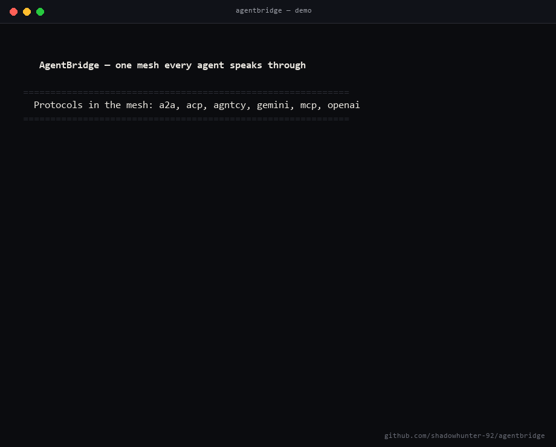
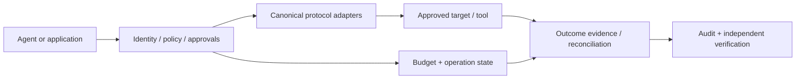

# AgentBridge

> **Production target restriction:** HTTP named-target execution is disabled for
> generic MCP/A2A/ACP transports in `prod` and `production` until destination-atomic
> authority/fencing is qualified. Translation and nonproduction synthetic evaluation
> remain available. See [destination contract](docs/PRODUCTION_TARGET_QUALIFICATION_2026-10-14.md).

**Protocol interoperability and governed execution for AI agents.**

[](https://github.com/shadowhunter-92/agentbridge/actions/workflows/ci.yml)
[](https://www.python.org/)
[](LICENSE)
[](SECURITY.md)

AgentBridge is an open-source Python project for translating selected AI-agent
tool-call formats and applying controls such as agent identity, authorization,
budgets, approvals and audit history. The long-term goal is a portable trust
layer that works **alongside** existing agent frameworks and gateways—not
another all-in-one agent platform.

> **Engineering alpha; production NO-GO.** The recorded `main` baseline is
> `73aafd60a0eec121a10245a307a4a8ee268f7ed5`. This documentation describes the
> recorded cumulative draft baseline `46777f8c953690fca81c6d11e7b70372b8dd5c77`
> (PRs #56–#69), followed by queued acceptance and private preparation at
> `893fdba4d3d1928bd66491affcb87e01a263b063` (draft PR #70). The later private
> first-admission extension requires its own selected-head checks and evidence.
> These remain separate from `main` and the older local unsigned evaluator wheel.
> Source integration does not establish a signed release or production acceptance.
> [Current source, evidence and open gates](docs/CURRENT_ALPHA_STATUS.md) ·
> [Documentation index](docs/README.md) · [Security policy](SECURITY.md)



## Protecting the code and release boundaries

This code is published under Apache 2.0; the existing license grants remain in force. Security-critical changes require review and must not imply certification. See [code/IP safeguards](docs/CODE_PROTECTION_AND_IP_POLICY_2026.md), [four-product execution criteria](docs/FOUR_PRODUCT_EXECUTION_GATES_2026.md), and the [security policy](SECURITY.md). The reconciled R4 engineering work and reviewed fixes are incorporated in `main` through [PR #41](https://github.com/shadowhunter-92/agentbridge/pull/41). Production acceptance remains open.

## Why AgentBridge?

AI-agent frameworks can call tools, but organizations also need to answer:

- **Who** requested an action, and with which authority?
- **Exactly what** parameters, target and cost were authorized?
- **What happened** if the connection dropped after execution?
- **What evidence** can an independent reviewer actually verify?

The protocol mesh provides a useful starting point. The evolving Trust and
Evidence components aim to address the more difficult authorization, ambiguous
outcome, reconciliation and auditability questions. Those guarantees remain
**scope- and destination-dependent**, not universal.

## At a glance

| Capability | Cumulative draft scope | Qualification remaining |
| --- | --- | --- |
| Canonical tool-call translation across six adapter families | Limited subset with explicit unsupported-feature rejection | Full protocol lifecycle/version matrix |
| Agent signatures, budgets, policies and approval controls | Selected paths; opt-in enrolled tenant SDK/HTTP and shared-SQL admission/settlement | Remaining ingress, destination and adversarial qualification |
| SQLite / PostgreSQL support | Bounded tenant namespaces, offline migration, admission caps, retained-task/event-byte caps and shared tenant stream allocations | Large-history performance, protected retention, physical connection limits, live migration and HA |
| Separately signed action receipt + readback verification | Tested in bounded sandbox / PostgreSQL paths | Independent administration and real destination acceptance |
| Production network isolation, HA and full MCP/A2A conformance | **Not qualified** | **Still not qualified** |
| Native queued tasks | Signed bounded acceptance; private current-authority preparation and atomic first admission with immutable operation linkage | Worker invocation, results, settlement, recovery and destination cancellation |
| Enterprise managed service or formal certification | Not available | Not available |

**Protocol families:** MCP, A2A, BeeAI ACP, OpenAI tool calling, Gemini tool
calling and AGNTCY ACP. A 6 × 6 basic call translation matrix does **not**
imply all sessions, streaming, async tasks, extensions or current-version
transports are interoperable. See [protocol details](docs/PROTOCOL_SUPPORT.md)
and the [review compatibility contract](docs/PROTOCOL_COMPATIBILITY_2026.md).

## Quick start

**Requires Python 3.11 or 3.12.** Use a new virtual environment and synthetic
or non-sensitive data for the examples.

```bash
git clone https://github.com/shadowhunter-92/agentbridge.git
cd agentbridge
# Pin the recorded main baseline for this basic example:
git checkout --detach 73aafd60a0eec121a10245a307a4a8ee268f7ed5
python -m venv .venv

# Activate your virtual environment first:
# macOS/Linux: source .venv/bin/activate
# Windows PowerShell: .venv\Scripts\Activate.ps1

python -m pip install -e ".[mcp]"
python examples/quickstart.py
python examples/demo_story.py
```

This pins `main`, not the cumulative tenant draft. For that draft, select
`893fdba4d3d1928bd66491affcb87e01a263b063` explicitly and use its documented
opt-in tenant factory. Editable source installation is not installation of the
local evaluator wheel or a signed public release. The main CI badge above tracks
`main`; it does not attest to the selected draft. See [source pins](docs/CURRENT_ALPHA_STATUS.md).
That pin qualifies queued acceptance and preparation only; later private
[first-admission linkage](docs/QUEUED_INTENT_PREPARATION_2026-10-18.md)
requires its own exact-head evidence and adds no executable task API.

To execute the local test suite:

```bash
python -m pip install -e ".[test]"
python -m pytest tests/ -q
```

Some PostgreSQL tests require an **explicit disposable test database** and are
skipped without it. Never point test or recovery drills at production data.
Read [CONTRIBUTING.md](CONTRIBUTING.md) for the development setup.

### Translate a tool call

```python
from src.protocols import default_registry
from src.protocols.canonical import CanonicalCall

call = default_registry.get("openai").from_canonical_call(
    CanonicalCall("add", {"a": 2, "b": 3})
)
translated = default_registry.translate_call(call, "openai", "mcp")
print(translated)
```

This example translates a **basic tool-call shape**. It does not prove remote
execution, authorization or full protocol lifecycle fidelity.

## Architecture



The translation mesh is already useful on its own. The security-critical
execution and evidence path is being qualified incrementally. A signed receipt
is a statement from its signer, **not automatic proof of a remote side effect**.

## One foundation, four proposed offerings

| Offering | Intended role | Stage |
| --- | --- | --- |
| **AgentBridge OSS** | Open-source adapters, examples and reusable SDK | Engineering alpha; installable verification SDK |
| **AgentBridge Trust** | Identity, policy, approvals and safe execution | Engineering and hardening |
| **AgentBridge Evidence** | Receipts, independent observation and audit verification | Bounded technical demonstrations |
| **AgentBridge Enterprise** | Managed policies, deployment, support and governance | Commercial hypothesis, **not shipped** |

These are **product directions**, not four available paid products. Independent
adoption and willingness to pay have not yet been established.

## Documentation

| Start here | What it covers |
| --- | --- |
| [Quick API reference](docs/API_REFERENCE.md) | Control plane interfaces |
| [Integrations](docs/INTEGRATIONS.md) | Framework examples |
| [Protocol support](docs/PROTOCOL_SUPPORT.md) | Adapter mapping and limitations |
| [Deployment](docs/DEPLOYMENT.md) | Developer setup and deployment considerations |
| [Roadmap](docs/ROADMAP.md) | Scope and known limitations |
| [OSS evaluator kit](docs/OSS_EVALUATION_KIT.md) | Pinned synthetic/read-only assessment |
| [Production gate register](docs/RC_INTERNAL_COMPLETION_AND_NOGO.md) | Review evidence and remaining blockers |
| [Security policy](SECURITY.md) | Responsible vulnerability disclosure |
| [Contributing](CONTRIBUTING.md) | Local setup, PRs, review expectations |

## Get involved

We especially welcome feedback from engineers building agents that **change
external state**: payments, procurement, deployments, customer records or
other operational systems. What breaks during retries? How do you verify that
an action happened? What does your existing gateway already solve?

- Try the **basic local examples** and pinned synthetic evaluator workflow on `main`.
- [Report a reproducible bug](https://github.com/shadowhunter-92/agentbridge/issues/new/choose).
- [Request a developer evaluation](https://github.com/shadowhunter-92/agentbridge/issues/new)
  (no credentials, private logs or customer data in public issues).
- [Propose an improvement](CONTRIBUTING.md), ideally with a bounded failing test.

Independent evaluations and comparisons are more useful than GitHub-star counts.
We have **not** claimed external integrations or paying customers without
verifiable evidence.

## Security and license

AgentBridge **does not guarantee exactly-once external execution**, complete
MCP/A2A standards conformance, independent custody of production signing keys,
or readiness to run unsupervised high-impact actions. Review
[SECURITY.md](SECURITY.md) before testing privileged functionality and **do
not post vulnerabilities or secrets in public issues**.

Licensed under the [Apache License 2.0](LICENSE). See [AI assistance
disclosure](AI_DISCLOSURE.md) for development transparency.

This repository is the authoritative source for **AgentBridge by
`shadowhunter-92`**; it is not affiliated with unrelated projects using the
same name.

## Maintained engineering alpha

The maintained source combines the alpha documentation, R4 implementation and
reviewed audit fixes. Readiness depends on checks on the **exact selected commit**
and independent operational acceptance; a source merge does not constitute certification.

See [engineering release register](docs/RC_INTERNAL_COMPLETION_AND_NOGO.md),
[recovery/operator drills](docs/PRODUCTION_OPERATOR_DRILLS.md),
[limited protocol contract](docs/PROTOCOL_COMPATIBILITY_2026.md),
[release procedure](docs/RELEASE_PROCEDURE_2026.md), and
[external evaluator kit](docs/OSS_EVALUATION_KIT.md).

## Local continuation checks

From the pinned source checkout, run `python -m examples.qualify_trust_evidence`
for the controller-signed Trust/Evidence workflow. The optional durable task SDK
is documented in [task lifecycle](docs/DURABLE_TASK_LIFECYCLE.md).
Run `python tools/check_documentation.py` to check local Markdown targets.
Current source and branch evidence is indexed in [current alpha status](docs/CURRENT_ALPHA_STATUS.md); the [88-row handoff register](docs/HANDOFF_ACCEPTANCE_REGISTER_2026-10-14.md) preserves its historical checkpoint.
